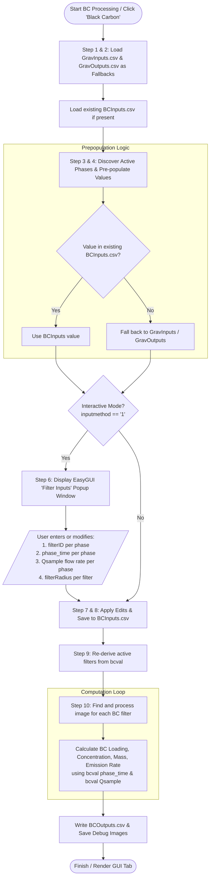

# Black Carbon (BC) Data Entry Workflow

> **Branch:** `black-carbon-second-window`  
> **Source Module:** [`LEMS/LEMS_BlackCarbon.py`](file:///Users/user/Documents/UCET%20software/Data-Processing-Software/LEMS/LEMS_BlackCarbon.py)  
> **HTML Documentation:** [`LEMS_BlackCarbon_Documentation.html`](file:///Users/user/Documents/UCET%20software/Data-Processing-Software/LEMS/Documentation/LEMS_BlackCarbon_Documentation.html)

---

## 1. Executive Summary & Purpose

In the `black-carbon-second-window` branch of the LEMS software, Black Carbon (BC) data entry has been decoupled from Gravimetric (Grav) data inputs and outputs. This decoupling accommodates physical sampling configurations such as three-line LEMS systems (e.g., 3 LPM sampling without a digital flow sensor, or 16.7 LPM channels) where the BC filter setup differs from the gravimetric filter setup.

### Key Capabilities
- **Independent Filter IDs**: The user can specify a BC filter number (`filterID_<phase>`) that is **completely different** from the gravimetric filter number specified in `GravInputs.csv`.
- **Independent Flow Rates**: The user can specify an air flow rate (`Qsample_<phase>`) that is **completely different** from the digital flow rate recorded in `GravOutputs.csv`.
- **Independent Phase Times**: The user can adjust exposure durations (`phase_time_<phase>`) independently.
- **Persistent Authoritative Record**: User-entered BC parameters are stored in `<testname>_BCInputs.csv`, which becomes the single source of truth for all downstream optical reflectance and emission calculations.

---

## 2. Workflow Diagram



---

## 3. Detailed Step-by-Step Workflow

### 1. Invocation
The BC workflow is executed via `LEMS_BlackCarbon(...)` defined in [`LEMS_BlackCarbon.py`](file:///Users/user/Documents/UCET%20software/Data-Processing-Software/LEMS/LEMS_BlackCarbon.py#L55).
It is typically launched from the LEMS Data Entry GUI ([`LEMS_DataEntry_L1.py`](file:///Users/user/Documents/UCET%20software/Data-Processing-Software/LEMS/LEMS_DataEntry_L1.py#L2464) or [`LEMS_DataEntry_L2.py`](file:///Users/user/Documents/UCET%20software/Data-Processing-Software/LEMS/LEMS_DataEntry_L2.py#L830)) when the user clicks the **"Black Carbon"** button, or via standalone script execution.

Paths resolved per test folder:
- `bcinputpath`: `<testname>_BCInputs.csv`
- `bcoutputpath`: `<testname>_BCOutputs.csv`
- `gravinputpath`: `<testname>_GravInputs.csv`
- `gravoutputpath`: `<testname>_GravOutputs.csv`
- `logpath`: `<testname>_log.txt`

---

### 2. Upfront Gravimetric Fallback Loading & Existing BC Check
[`LEMS_BlackCarbon.py` (Lines 85–128)](file:///Users/user/Documents/UCET%20software/Data-Processing-Software/LEMS/LEMS_BlackCarbon.py#L85-L128):
1. **`GravInputs.csv`**: Loaded if present. Provides gravimetric filter IDs (`filterID_<phase>`). If missing, a warning is logged without raising an unhandled exception.
2. **`GravOutputs.csv`**: Loaded if present. Provides gravimetric phase times (`phase_time_<phase>`) and digital flow rates (`Qsample_<phase>`).
3. **`BCInputs.csv`**: Loaded if it already exists from a previous run. Existing values in this file take highest precedence.

---

### 3. Phase Discovery & Input Pre-population
[`LEMS_BlackCarbon.py` (Lines 130–234)](file:///Users/user/Documents/UCET%20software/Data-Processing-Software/LEMS/LEMS_BlackCarbon.py#L130-L234):
- Active phases (e.g. `L1`, `hp`, `mp`, `lp`, `L5`) are discovered from keys containing `filterID_` in `GravInputs.csv` or `BCInputs.csv`. Any phase with a blank filter ID is skipped.
- For each active phase, default values are populated using the following priority:

| Variable | Priority 1 (Authoritative) | Priority 2 (Fallback) | Default if neither found | Units |
| :--- | :--- | :--- | :--- | :--- |
| `filterID_<phase>` | Existing `BCInputs.csv` | `GravInputs.csv` (`filterID_<phase>`) | `""` | `text` |
| `phase_time_<phase>` | Existing `BCInputs.csv` | `GravOutputs.csv` (`phase_time_<phase>`) | `""` | `min` |
| `Qsample_<phase>` | Existing `BCInputs.csv` | `GravOutputs.csv` (`Qsample_<phase>`) | `""` | `l/min` |
| `filterRadius_<filter>`| Existing `BCInputs.csv` | — | `1.95` | `mm` |

---

### 4. Interactive Data Entry Modal (`Filter Inputs`)
[`LEMS_BlackCarbon.py` (Lines 235–245)](file:///Users/user/Documents/UCET%20software/Data-Processing-Software/LEMS/LEMS_BlackCarbon.py#L235-L245):
When `inputmethod == '1'` (interactive mode), an `easygui.multenterbox` popup titled **`Filter Inputs`** appears.

The prompts are grouped logically by phase, followed by filter radii:
```text
Filter Inputs
Enter filter inputs needed for calculation.
Click OK to continue.
Click Cancel to exit.

filterID_hp:        [ 201              ]  <-- User can change from Grav filter!
phase_time_hp:      [ 45.0             ]
Qsample_hp:         [ 3.0              ]  <-- User can change from Grav digital flow!
filterID_L5:        [ 202              ]
phase_time_L5:      [ 30.0             ]
Qsample_L5:         [ 3.0              ]
filterRadius_201:   [ 1.95             ]
filterRadius_202:   [ 1.95             ]
```

#### Modifying Previously Entered Data
- **Via the Popup**: If `BCInputs.csv` already exists and you run Black Carbon interactively again (e.g. by clicking the "Black Carbon" button in the GUI), the popup **opens with your previously entered values pre-filled**. You can update any filter number or flow rate, and clicking OK saves the changes back to `BCInputs.csv`.
- **Via the CSV Directly**: You can also open `<testname>_BCInputs.csv` in Excel or a text editor to modify any values. When running in reprocess mode (`inputmethod == '2'`), the system reads the CSV directly without opening the popup.

#### How Users Override Flow Rates & Filter Numbers
1. **Different Filter Number**:
   - If the gravimetric filter in `GravInputs.csv` was `1`, but the BC sample was collected on filter `201`, the user changes `filterID_hp` from `1` to `201`.
   - The image lookup will now target `<testname>_201.jpeg` instead of filter `1`.
2. **Different Flow Rate**:
   - If the digital gravimetric line was pulling at `0.0014 l/min` (or whatever is in `GravOutputs.csv`), but the BC line was operating at `3.0 l/min` (or `16.7 l/min`), the user inputs `3.0` directly into `Qsample_hp`.
   - The BC concentration and emission calculations will use `3.0 l/min`.

---

### 5. Writing Authoritative `BCInputs.csv`
[`LEMS_BlackCarbon.py` (Lines 246–285)](file:///Users/user/Documents/UCET%20software/Data-Processing-Software/LEMS/LEMS_BlackCarbon.py#L246-L285):
- The script receives the edited values from the modal.
- Active filters are re-derived based on the new `filterID_<phase>` values entered by the user.
- If a new filter ID was entered, `filterRadius_<new_filter>` is automatically assigned (defaulting to 1.95 mm if not already set).
- All variables, units, values, and uncertainties are written out to `<testname>_BCInputs.csv`.
- On subsequent runs of the test, `BCInputs.csv` retains the user's custom filter numbers and flow rates.

---

### 6. Image Analysis & Decoupled BC Calculations
[`LEMS_BlackCarbon.py` (Lines 299–555)](file:///Users/user/Documents/UCET%20software/Data-Processing-Software/LEMS/LEMS_BlackCarbon.py#L299-L555):
For each active filter:
1. **Image Detection**:
   - The script searches for `<testname>_<filterID>.jpeg`, `.jpg`, or `.png`.
   - Locates QR codes (`detectQR`), calibrates color bars (`getGrayBarsRadial`), and finds filter deposit boundaries (`detectBCFilterFixed`).
   - Saves a debug verification image `<testname>_<filterID>_Debug.jpg`.
2. **Reflectance / Loading**:
   - Analyzes sampled RGB values against calibration curves (`rateFilter`) to calculate `bcLoading` in $\mu\text{g/cm}^2$.
3. **Decoupled Math**:
   - Exposure duration and flow rate are fetched directly from `bcval`:
     ```python
     exposedTime = bcval['phase_time_' + phases[filter]]
     airFlowRate = bcval['Qsample_' + phases[filter]]
     ```
   - `computeBCC(filterRadius, bcLoading, exposedTime, airFlowRate)` uses the BC-specific flow rate and exposure time to calculate:
     - `BCconcentration_<filter>_<phase>` ($\mu\text{g/m}^3$ / $\text{cm}^3/\mu\text{g}$)
     - `BCmass_<filter>_<phase>` ($\mu\text{g}$)
     - `BCemissionrate_<filter>_<phase>` ($\mu\text{g/min}$)
4. **Outputs Saved**:
   - Writes all final metrics to `<testname>_BCOutputs.csv`.
   - Returns logs and image previews back to the GUI for the **"Black Carbon Calculations"** tab.

---

## 4. Summary of Differences: Before vs. After in this Branch

| Feature | Prior Behavior | `black-carbon-second-window` Branch |
| :--- | :--- | :--- |
| **Filter ID Selection** | Tied directly to `GravInputs.csv` filter numbers. | **Independent**: Discovered from `GravInputs.csv` as a default, but editable to any BC filter number in the popup and stored in `BCInputs.csv`. |
| **Flow Rate (`Qsample`)** | Read strictly from `GravOutputs.csv` (digital flow sensor). | **Independent**: Pre-populated from `GravOutputs.csv` as fallback, but freely editable by the user (e.g. 3 LPM / 16.7 LPM) and stored in `BCInputs.csv`. |
| **Calculation Source** | Used `gravovals['Qsample_*']` and `gravovals['phase_time_*']`. | Strictly uses `bcval['Qsample_*']` and `bcval['phase_time_*']`. |
| **Fallback & Resilience** | Failed if `GravOutputs.csv` was missing. | Gracefully warns if Grav files are missing, allowing standalone BC entry. |
| **Persistent Storage** | Minimal/fixed radius storage only. | Full specification stored in `<testname>_BCInputs.csv`. |
