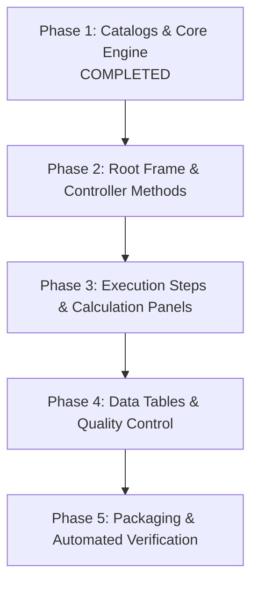

# LEMS_DataEntry_L2 Translation Implementation Plan

## Executive Summary
This plan outlines the phased internationalization (i18n) of [LEMS_DataEntry_L2.py](file:///Users/user/Documents/UCET%20software/Data-Processing-Software/LEMS/LEMS_DataEntry_L2.py) across **English (en)**, **French (fr)**, **Spanish (es)**, and **Portuguese (pt)**, matching the standard established in [LEMS_DataEntry_L1_ML.py](file:///Users/user/Documents/UCET%20software/Data-Processing-Software/LEMS/LEMS_DataEntry_L1_ML.py).

---

## 1. Current State & Progress to Date

### Completed
- **Language Catalogs & Fallback Parity**:
  - Expanded translation keys from 259 to **299 keys** in [`lang/en.json`](file:///Users/user/Documents/UCET%20software/Data-Processing-Software/LEMS/lang/en.json), [`lang/fr.json`](file:///Users/user/Documents/UCET%20software/Data-Processing-Software/LEMS/lang/fr.json), [`lang/es.json`](file:///Users/user/Documents/UCET%20software/Data-Processing-Software/LEMS/lang/es.json), and [`lang/pt.json`](file:///Users/user/Documents/UCET%20software/Data-Processing-Software/LEMS/lang/pt.json).
  - Synchronized the embedded fallback dictionary in [LEMS_i18n_data.py](file:///Users/user/Documents/UCET%20software/Data-Processing-Software/LEMS/LEMS_i18n_data.py) for offline/standalone execution.
  - Ran [verify_i18n.py](file:///Users/user/Documents/UCET%20software/Data-Processing-Software/LEMS/verify_i18n.py): **100% key parity** verified across all 4 catalogs, helper formatting functions passed.
- **Safety Pre-conditions**:
  - Clean pre-edit backup created at [LEMS_DataEntry_L2_backup.py](file:///Users/user/Documents/UCET%20software/Data-Processing-Software/LEMS/LEMS_DataEntry_L2_backup.py).

---

## 2. Key Codebase Findings & Structural Nuances in L2

During initial AST/text analysis of [LEMS_DataEntry_L2.py](file:///Users/user/Documents/UCET%20software/Data-Processing-Software/LEMS/LEMS_DataEntry_L2.py) (5,196 lines), the following structural patterns and pre-existing bugs were identified:

1. **Typos & Dead References in Original Code**:
   - `self.innner_frame` (3 n's) in `on_browse`.
   - `command=self.on_ok` in `on_browse` popup (referencing non-existent method instead of `self.on_okay`).
2. **Notebook Tab Lifecycle & Language Sensitivity**:
   - In `on_okay` and `on_nonint`, tabs are dynamically cleared:
     ```python
     for i in reversed(range(self.notebook.index("end"))):
         if self.notebook.tab(i, "text") != "Folder Selection":
             self.notebook.forget(i)
     ```
     When running in non-English (`Sélection de dossier`, `Selección de carpeta`), this check failed and would delete the root folder selection tab.
     *Resolution*: Update check to match `if i == 0 or self.notebook.tab(i, "text") in ("Folder Selection", t("tab.folder_selection")):`.
3. **ScrollableNotebook Parentage**:
   - Parent container for `ScrollableNotebook` should be `self` (not `root`) so `rebuild_ui` can cleanly refresh all widgets without orphan windows.
4. **Recent Table Enhancements**:
   - `CustomTable` contains interactive components (search highlighting, selection counter, checkboxes) which must be preserved while translating all button and status labels.

---

## 3. Phased Implementation Plan



### Phase 1: Catalogs & Core Engine (COMPLETED)
- [x] Extract all L2 strings (labels, buttons, dialogs, warnings, instructions, tabs).
- [x] Add 40 new keys (total 299) to `en.json`, `fr.json`, `es.json`, `pt.json`.
- [x] Regenerate embedded fallback in [LEMS_i18n_data.py](file:///Users/user/Documents/UCET%20software/Data-Processing-Software/LEMS/LEMS_i18n_data.py).
- [x] Validate with [verify_i18n.py](file:///Users/user/Documents/UCET%20software/Data-Processing-Software/LEMS/verify_i18n.py).
- [x] Create clean backup [LEMS_DataEntry_L2_backup.py](file:///Users/user/Documents/UCET%20software/Data-Processing-Software/LEMS/LEMS_DataEntry_L2_backup.py).

---

### Phase 2: Root Frame & Workflow Orchestration
**Scope**: Main entry window, language switching dropdown, and high-level run handlers.
- **Top Imports**: Add `LEMS_i18n as i18n`, `t`, `t_field`.
- **`LEMSDataCruncher_L2` Class Structure**:
  - Implement `change_language(self, event=None)` and `rebuild_ui(self, saved_folder="")`.
  - Add `ttk.Combobox` language switcher in `build_ui` (matching L1 layout).
  - Translate instructions (`instructions.folder_selection_l2`), labels (`label.select_folder`), and action buttons (`btn.setup_and_run_l2`, `btn.run_saved_l2`).
- **`on_browse(self)`**:
  - Translate folder select dialogs, confirmation prompts, error alerts.
  - Fix `self.innner_frame` typo and `on_okay` command link.
- **`on_okay(self)` & `on_nonint(self)`**:
  - Translate all generated tab titles (`Quality Control`, `Custom Outputs`, `Phase Cut Period`).
  - Fix tab deletion loop so tab 0 is never removed regardless of active language.
- **`update_input(self)`**:
  - Translate missing parameter dialogs, calibration questions, and confirmations.
- **`__main__`**:
  - Add `--lang` command-line argument parser, set localized window title `t("app.title_l2", version=version)`.

---

### Phase 3: Workflow Step Dialogs & Calculation Panels
**Scope**: The individual processing step triggers and their associated interactive frames.
- **Button Handlers**:
  - `on_energy(self)`: Energy calculations status and warnings.
  - `on_cali(self)`: Calibration file checks and popups.
  - `on_bkg(self)`: Background subtraction dialogs.
  - `on_gas(self)`: Gas checks error dialogs.
  - `on_grav(self)`: Gravimetric calculation confirmations.
  - `on_bc(self)`: Black carbon computation popups.
  - `on_em(self)`: Emissions calculations triggers.
  - `on_cut(self)`: Interactive phase selection popup (`title.select_phase`, `label.choose_phase`, `btn.ok`, `btn.cancel`).
  - `on_all(self)`: Batch processing tabs (`Summary`, `ISO Summary`).
  - `on_custom(self)`: Custom cut output generation dialogs.
- **Calculation Frame Classes**:
  - `Cut(tk.Frame)`: Cut period review, instructions, cut times, plot update buttons.
  - `Emission_Calcs(tk.Frame)`: Emission parameters, instructions, headers, exit buttons.
  - `BC_Calcs(tk.Frame)`: Black carbon instructions and labels.
  - `Grav_Calcs(tk.Frame)`: Gravimetric setup labels and headers.
  - `Subtract_Bkg(tk.Frame)`: Realtime data warning messages and labels.
  - `Adjust_Frame(tk.Frame)`: Time series adjustment instructions and buttons.

---

### Phase 4: Data Tables & Quality Control
**Scope**: Results visualization and data validation interfaces.
- **`Quality_Control(tk.Frame)` & `Quality_Checks(tk.Frame)`**:
  - Localize all fault checking headers, threshold alerts, and exit controls.
  - Translate warnings: ambient temperature drift, ISO 30-minute duration requirements.
- **`ISOTable(tk.Frame)`**:
  - Translate ISO compliance headers, summary labels, and save/export buttons.
- **`CustomTable(tk.Frame)`**:
  - Preserve search filtering and checkbox selection state.
  - Translate `label.search`, `label.selected_count`, `btn.select_all`, `btn.deselect_all`, and `btn.save`.
  - Localize table header column names.
- **`CompareTable(tk.Frame)` & `OutputTable(tk.Frame)`**:
  - Translate table columns, action buttons, and status notices.

---

### Phase 5: Verification, Spec File & Packaging
**Scope**: End-to-end testing and build configuration.
- **Syntax & Compilation**:
  - Run `python3 -m py_compile LEMS_DataEntry_L2.py`.
- **Headless UI & Language Switching Test**:
  - Launch `LEMSDataCruncher_L2` in headless Tk mode.
  - Programmatically toggle `change_language` across `en` -> `fr` -> `es` -> `pt` -> `en`.
  - Validate that tab names, labels, and buttons re-render in the selected language without exceptions.
- **PyInstaller Spec Update**:
  - Update [LEMS_DataEntry_L2.spec](file:///Users/user/Documents/UCET%20software/Data-Processing-Software/LEMS/LEMS_DataEntry_L2.spec) to bundle `datas=[('lang', 'lang')]`.
- **Workspace Cleanup**:
  - Remove scratch testing scripts (`test_run.py`, etc.).

---

## 4. Work Paused
Work is currently paused at the end of **Phase 1** as requested. All preparations, backup files, and verified catalogs are in place ready to begin **Phase 2**.
